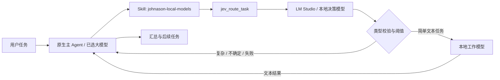

# 多模型、Skill 与本地 Jev 类模型协作

用户需求是让当前 DSH 保留本地功能与官方升级边界，同时配置多个模型、通过 Skill 调用本地 LLM，并利用 LM Studio 上的 Jev 类小模型快速指派任务。本次 Jev 明确指本地的 `jev-style-qwen3.5-2b-decision`，不接入 TypeSafe 云端，也不安装社区插件覆盖现有行为。

## 分工

主 Agent 保留规划、原生工具审批及最终交付责任。混合工具执行独立、有界的文本子任务，不自动改写主会话选中的模型，不执行工作模型返回的工具调用，也不因模型判断扩充权限。需要文件修改或多步工具操作时，由主 Agent 按已有权限继续。

模型 API 插件负责多个供应商连接、每个连接多个模型，以及向现有连接追加模型。追加只修改该连接的模型数组，保留已有模型参数、端点与凭据。原生 Models 页面继续负责完整编辑。

独立 `@johnason/dsh-local-models` bundle 同时包含 Host 工具及 Web 配置入口；headless profile 使用 Host 部分。Host 实现位于 `src/plugins/local-models/`，官方类型/Schema 加载集中在 `src/platform/local-model-api.mjs`。通过原生 `ctx.skills.register()` 注册随插件启停的 Skill，不向用户技能目录复制或覆盖文件。

## 接口

| 接口 | 作用 |
|---|---|
| `local_model_list` | 读取配置的 LM Studio 模型列表和角色 |
| `local_model_generate` | 指定配置中的工作模型或决策模型，完成一次文本生成 |
| `jev_route_task` | 请求本地结构化路由判断；符合阈值时调用本地工作模型，否则交回主 Agent |
| `jev_route_tasks` | 单次工具调用接收最多 200 个唯一 ID 和任务，串行完成决策，不执行工作模型 |
| `johnason-local-models` Settings namespace | 保存本地端点、模型角色、阈值、超时、输出、并发和调用预算 |

工具不接受 API 地址或密钥参数，也不隐式读取整个会话、仓库或日志。任务文本由主 Agent 显式给出；只有本机 loopback 地址可用，HTTP 重定向被拒绝。需要认证时，从 Vault 解析配置的凭据引用；无认证的本地服务不需要占位密钥。浏览器保存配置不触发推理，只有“读取本地模型”按钮触发模型目录请求。

每次工具调用固定配置快照，传递取消信号并限制输入、输出、并发及实际推理调用次数。单条工具限制整体超时，批量工具对每个请求独立计时。一次“决策 + 工作模型”消耗两次模型调用。具备原生轮次投影时按轮计算；无轮次上下文时采用保守的会话限额。强制记忆沙箱继续使用已有工具白名单；新工具不绕过它。

## 单轮批量判断

本地生成预算默认 256 次/轮，设置上限 2000 次；已保存的旧预算仍须通过插件配置修改。一次纯判断消耗一次额度，因此 200 条需要本轮至少剩余 200 次。预算不是并发数：批量工具内部依序处理，保持每条独立超时和整个任务的取消能力。

批量参数为 `tasks: [{ id, task }]`，最多 200 条，ID 不重复。配置固定后只调用决策模型，每个结果包含 ID、状态、实际路由、置信度、原因和本地耗时，不回显工单全文。调用失败保留已完成结果、错误项目及未处理 ID，不把失败回退算成有效的 `main` 判断。主 Agent 只需发起一次批量工具调用，避免每条工单往返云端编排。

单条耗时统计本地请求及校验，整批耗时与 DSH 云端编排耗时应分开。100 条在旧 8 次额度下需 13 轮，200 条需 25 轮；提高额度后轮数不再取决于这项旧限制，但真实总耗时仍取决于每次模型推理及编排开销。

## 本地 Jev 类模型的语义

LM Studio 的 Chat Completions 接口支持 `response_format: json_schema`，返回的 JSON 仍需从正文解析并验证。本次判断协议限定为 `route: local | main` 与 `confidence: 0..1`；置信度是模型自报值，不是 TypeSafe 原生 Choice/Noul 的校准概率。[LM Studio 官方结构化输出说明](https://lmstudio.ai/docs/developer/openai-compat/structured-output)

社区 `buberlo/dsh-jev` 提供了决策结果驱动路由、目标可用性检查及权限只能收敛的参考。本项目采用自己的本地 LM Studio 适配器，不将社区包的云端配置、工具安全拦截或测试数字视为本地实现已经具备的能力。[参考项目](https://github.com/buberlo/dsh-jev)

首次只读发现确认本机决策模型已加载，工作模型 `qwen3.8-27b-uncensored-mlx` 当时未加载。一个无用户数据的短提取样本返回合法 JSON，用时 0.709 秒；这证明该次接口连通，不代表普遍延迟、路由准确率或大工作模型已完成实测。
