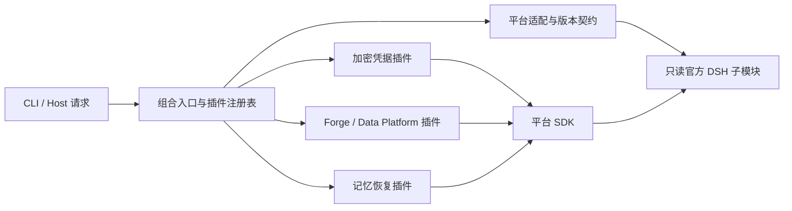

# DSH 平台升级与本地插件边界

本轮将可隔离的实现分为官方平台适配与本地业务插件；同一 Node 进程内仍使用 Cordis 服务注入。官方子模块保持原样，旧 `src/*.mjs` 入口继续转发，因此已有 profile 的 `name` 匹配条件和外部导入不需要因目录变化而修改。

## 已实施的边界

| 位置 | 职责 |
|---|---|
| `apps/dsh-agent/src/platform/` | 官方路径、加载入口、profile 组合、CredentialProvider、Authorization、Session/Workspace SDK 及事件集合兼容层 |
| `apps/dsh-agent/src/plugins/index.mjs` | 本地插件清单、固定公开入口、配置与单份浏览器资源、启动前准备和释放 |
| `apps/dsh-agent/src/plugins/credentials/` | Vault、锁、凭据接口、本地页面、进程内浏览器签名 |
| `apps/dsh-agent/src/plugins/systems/` | Forge/Data Platform 命令、授权流、本地页面和 CLI |
| `apps/dsh-agent/src/plugins/memory/` | 记忆与 Effect 存储、分页、工具、审计、恢复、本地页面及沙箱协作 |
| `mvp/sidecars/deepseek-harness/src/platform-runtime.ts` | Workbench 唯一官方深路径导入边界 |
| `mvp/sidecars/deepseek-harness/src/native-session.ts` | Workbench 历史、流、工具、取消的版本适配；通过版本化 adapter 契约供 Host 调用 |

20 个业务实现移入插件域，原入口保留。页面及 browser 源文件维持单份。浏览器插件由平台部署到对应 `profiles/<profile>/node_modules`，遵循新版原生解析器的 profile 作用域；不依赖共享 `profiles/node_modules` 中的任意包。插件声明的公开入口继续使用旧路径和包名，不能仅因实现位置变化就替换用户 profile 中的 name guard。

记忆页面创建的新会话通过原生 Workspace/Session controller 关联工作区，使聊天输入可用。既有未开始会话只在用户显式保存配置时，通过 Workspace 成员接口关联原会话；不重建 Agent、不改写历史。读取配置不执行这一步。配置按会话互斥，关联失败不提交新配置；异步关联返回后仍复核版本和运行/历史门禁。Workspace 能力只影响可选 Web 路由，不成为 headless 记忆插件的必需服务。

共享版本策略是 `mvp/src/workbench/runtime/deepseek_harness/platform-release.json`，由 JS 构建与 Python source gate 共同读取，记录官方 revision、版本、固定 package manager 和 adapter contract。它不含凭据，也不代替 Git gitlink。Sidecar 的 `component-manifest.json` 统一模块/产物清单，新增模块必须进入真实构建证据。

## 后续升级流程

1. 在隔离候选更新官方 gitlink 和共享 release JSON；不编辑官方实现。
2. 执行 `node apps/dsh-agent/scripts/check-platform.mjs`，验证 revision、版本、包管理器、官方 checkout 与插件依赖边界。此检查要求父仓库 HEAD 中的 gitlink 已更新。
3. 运行平台契约及插件源码测试。若官方签名变化，优先修改平台适配；涉及下面清单中的行为变化时，必须补相应真实契约回归。
4. 冻结安装并原生构建，再构建 Workbench sidecar，生成真实 source manifest 与 gate manifest。清单不能用手改 hash 代替构建。
5. 运行原生、浏览器、权限及恢复验收。先验证隔离的新数据根，再单独处理历史数据迁移与上线切换。

启动器 doctor 的“产物存在”只是快速诊断；版本与内容是否匹配由平台契约、构建 receipt 和严格 source gate 判断。架构边界检查会拒绝业务插件重新导入官方内部文件。它不能保证未经测试的官方版本自动兼容。

## 不能直接完成完全隔离的清单与建议

| 优先级 / 内容 | 当前隔离程度与原因 | 推荐演进 / 需讨论的取舍 |
|---|---|---|
| P0 旧记忆格式迁移 | 官方 v0 迁移器拒绝 required 自定义事件；事件重编号会影响既有审计证据。未迁移用户数据。 | 推荐先定义不可变的旧序号→新序号/事件证据映射与双版本读取，再申请官方迁移扩展钩子。替代方案为独立附属日志，但迁移与双日志事务成本更高。禁止忽略 required 事件或重签历史 hash。 |
| P1 required 事件注册 | Set 修改已集中到 `platform/memory-api.mjs`，仍非正式插件 API。 | 推荐上游增加事件 codec/registry 生命周期接口；获得接口前保留固定版本校验和引用计数契约测试。 |
| P1 记忆上下文投影 | 业务仍依赖 session surface、pre-step 时序和来源关联。已通过 SDK 将移除的 `session.events` 改为 `snapshotEvents()`，但该官方 API 也已标记 deprecated。 | 推荐定义平台 `ContextProjection` 与持久事件读取接口，逐步把 append/replace 决策移入平台；用 projection/persistence 接口替代完整快照，避免依赖后续可能移除的兼容 API。 |
| P1 沙箱与工具拦截 | guard、pre/post execute、token、callId、PTC 与 sandboxPolicy 仍是共同约束。已适配异步 `confine`，准备期间取消不得启动命令；执行仍限本地 sandbox，超时从进程启动计时。 | 推荐先保留同进程、集中能力协商与事件契约；远端执行需同时适配 sandbox/fs/subprocess，独立插件进程还需事务/取消/未知副作用协议，作为后续单独项目。 |
| P1 凭据 provider 替换 | 平台 profile 仍需替换官方 base bundle 的唯一 provider；严格拒绝重复或无加密 provider。 | 推荐推动官方 provider override 接口；当前继续按固定版本检查 base bundle 结构，不能变成宽松文本替换。 |
| P1 Trusted Core 启动顺序 | 必须在 native environment snapshot 前预初始化并清理 DB/JWT 环境；生命周期按进程共享。 | 已注册为 pre-launch/dispose。推荐维持每进程一个活动 runner；并发多实例需要资源作用域和引用计数。dump-config 不初始化真实 Core。 |
| P2 浏览器签名保留键 | 只对官方 browser-session record 使用进程内初始化，受 reserved key/record shape 约束。 | 继续精确键匹配和官方 BrowserAuth 契约测试；长期让原生浏览器认证与模型凭据生命周期分离。 |
| P2 页面 slots 与 index 注入 | Memory dock 使用官方 slots；前端依赖声明已指向提供 slots 的 `dsh-client-ui-renderer`，并通过源 manifest 校验；部分入口仍用 tapIndex 插入链接。 | 推荐全部收敛为官方导航/工具栏 slot，待上游提供稳定 slot 清单。现阶段保留插件发现、依赖声明与真实浏览器集成测试。 |
| P2 Workbench 历史与模型适配 | 官方深路径已集中，Session/AgentLoop 的历史组装仍需维护。 | 推荐在官方提供历史导入/SDK adapter 接口后切换；保留 V3 系统首节点、流与持久事件分离、取消完成的真实契约测试。 |

本轮实现不会将“目录已经隔离”描述为插件 ABI 已全面稳定。建议下一轮先讨论 P0 历史迁移，再决定 P1 正式扩展接口与独立进程的投入顺序。构建完成也不解除 P0 的既有数据启用阻断。

## 本轮构建清理边界

构建候选位于独立工作树。用户确认方案后，执行了冻结安装和官方构建；清理范围限定为该候选内 `.dsh-build/client-build-environment.json`、`native/system/.release/native-build-*`、过期 `lib/typert.remote-client.{js,d.ts,d.ts.map}`、Web `apps/web/dist` 及本轮安装临时文件。原工作树、源码、Vault、业务数据库和用户会话不在清理范围。验收使用新建夹具，原运行版本尚未切换。
